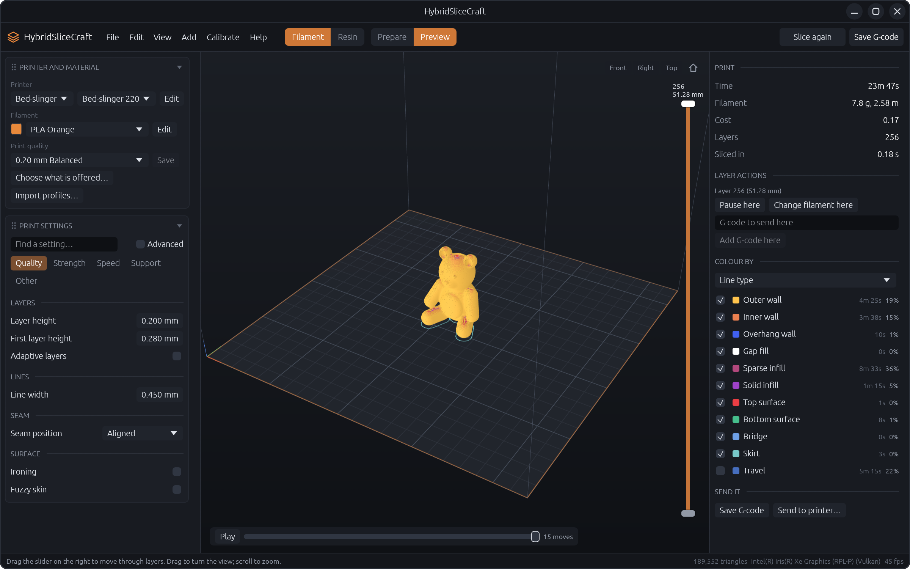
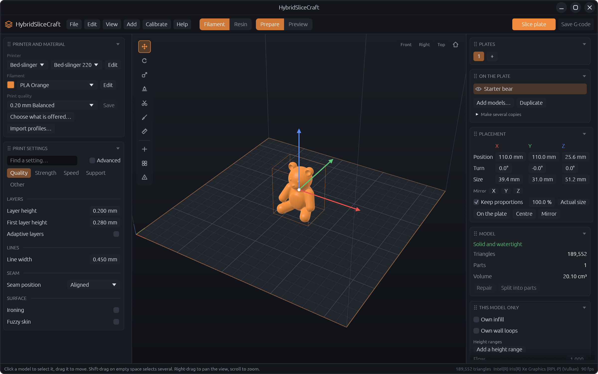
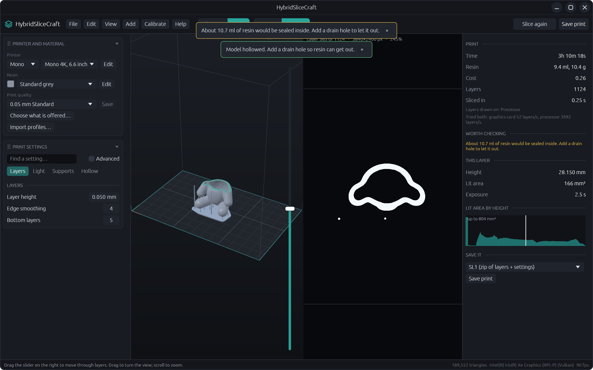
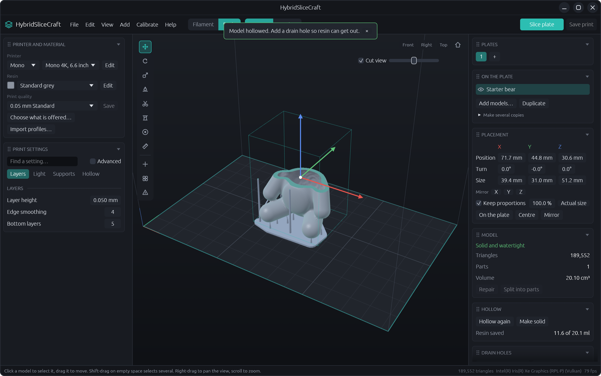
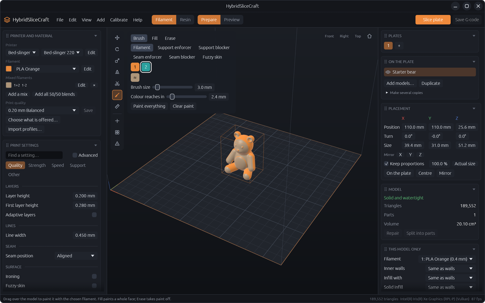
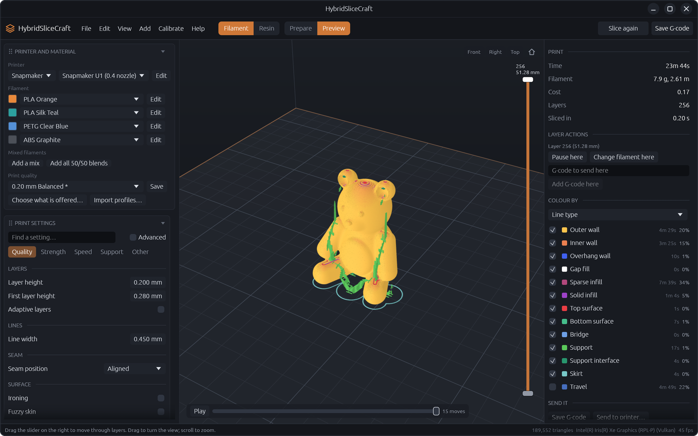
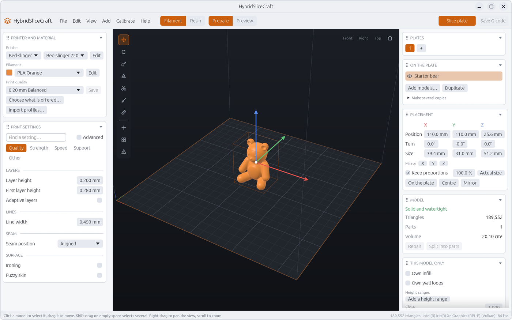

<h1 align="center">HybridSliceCraft</h1>

<p align="center">
A hybrid slicer for filament (FDM) and resin (MSLA) 3D printers, in one fast desktop program.<br>
One native program written in Rust that draws on the graphics card.
</p>

<p align="center">
<a href="https://github.com/Jorgen-VikingGod/HybridSliceCraft/releases/latest"></a>


<a href="LICENSE"></a>
</p>

<p align="center">
<a href="#features">Features</a> ·
<a href="#download">Download</a> ·
<a href="#getting-started">Getting started</a> ·
<a href="docs/manual.md">Manual</a> ·
<a href="#development">Development</a> ·
<a href="#contributing">Contributing</a> ·
<a href="#license">License</a>
</p>

<p align="center">

</p>

<table align="center">
<tr>
<td align="center"><br>Painting with filaments</td>
<td align="center"><br>Resin preview</td>
<td align="center"><br>Hollowing and supports</td>
</tr>
<tr>
<td align="center"><br>Mixed filaments</td>
<td align="center"><br>Tree supports</td>
<td align="center"><br>Light theme</td>
</tr>
</table>

<p align="center">
<b><a href="docs/manual.md">Read the manual</a></b>: every feature explained, with pictures, examples and hints.
</p>

<p align="center">
HybridSliceCraft is one of the Craft apps: it is built on <a href="https://github.com/storytold/craft-libs">craft-libs</a>,
the shared libraries of the ArtCraft community, so its window, menus and keys work like those of the other
Craft apps.
</p>

## Features

| | |
|---|---|
| **Filament (FDM)**<br>walls, seventeen infill patterns, grid and tree supports, Z contouring, arc fitting, Marlin, Klipper and RepRapFirmware | **Resin (MSLA)**<br>automatic supports with a raft, hollowing with drain holes, edge smoothing, SL1, CTB, GOO and Anycubic files |
| **Colour**<br>paint models with filaments, mix filaments layer by layer, a different filament or nozzle for each kind of line | **Checks before printing**<br>parts that start in mid-air, resin trapped inside, time, filament, resin and cost estimates |
| **Your own presets**<br>import OrcaSlicer and Bambu Studio presets; settings without a match are listed, never dropped | **At home on every desktop**<br>light and dark theme, its own title bar, four languages, keyboard shortcuts you can change |

<details>
<summary><b>Filament (FDM)</b></summary>

- Walls, gap fill and thin-wall detection, top and bottom skins, bridges and overhang slow-down
- Seventeen infill patterns: grid, lines, rectilinear, triangles, cubic, quarter cubic, stars, gyroid, honeycomb,
  3D honeycomb, 2D lattice, concentric, cross hatch, lightning-style, Hilbert curve, Archimedean chords,
  octagram spiral
- Grid and tree supports with interface layers
- Skirt, brim (outside, inside holes or both) and raft
- Seam placement, ironing (all top surfaces, topmost only, or all solid layers), fuzzy skin (outline, holes or
  both), spiral vase, adaptive layer heights
- **Z contouring** (Z anti-aliasing): top surfaces, ironing and the walls under them follow the model's slope up
  and down within a layer, which smooths the steps on domes, chamfers and gentle slopes
- Cooling, time and filament estimates that account for acceleration
- Wall order options (inner-outer-inner, reversed direction)
- **Pause, filament change or any G-code at a layer**: add them from the preview at the layer the slider is on;
  they are saved in the project
- Acceleration, flow ratio and (for bridges, support interface and ironing) fan speed for each kind of line, and
  walls that slow down in four steps by how much they hang in the air
- Z-hop types (straight, slope or spiral), lift only between two heights, retract at every layer change, and
  machine limits (speed, acceleration, corner speed) sent to Marlin, Klipper or RepRapFirmware
- Scarf seam (the outer wall fades in and out at the seam), mouse-ear brim pads at sharp corners, and a grid
  style for supports
- Looser top and bottom surfaces, thick round-strand bridges, and slicing aids: separate hole size correction,
  closing small cracks in a model's skin, and polyholes that make small round holes print to size
- **Height ranges**: give a model other walls, infill density or infill pattern between two heights
- No-go areas on the bed that arranging avoids
- Input shaper settings and object labels so a failed object can be skipped mid-print (Klipper, Marlin)
- Snapmaker U1 printer presets (four tool heads, five nozzle choices), with start and end scripts from
  OrcaSlicer's profile
- Arc fitting (G2/G3), pressure advance, Marlin, Klipper and RepRapFirmware output
- Preview by line type, speed, flow, layer height, width, fan, temperature, layer time or filament
- Calibration tests: temperature tower, flow, max flow tower, speed ripple tower, retraction, pressure advance,
  first layer
- Sending to OctoPrint, Moonraker, PrusaLink or Duet printers over the local network

</details>

<details>
<summary><b>Several filaments, painting and mixing</b></summary>

- Several filaments in one print, with a prime tower, and a flush volume for each pair of filaments (the prime
  tower purges what the change needs)
- **Paint with filaments**: brush, fill and erase tools colour the model's surface; each colour prints with its
  own filament and reaches a chosen depth into the part
- **Mixed filaments** (full-spectrum colour mixing): alternate a few filaments layer by layer in a repeating
  pattern, such as red, yellow, yellow, so the eye blends them into orange. Make mixes from a ratio, a typed
  pattern, or by picking a colour and letting the program find the closest blend of your filaments; paint them
  on a model like any filament. Best with a tool changer, thin layers (0.08 to 0.12 mm), short patterns and
  translucent filament
- **A filament for each feature**: pick a different filament for a model's walls, inner walls, sparse infill,
  solid infill, top surface, bottom surface, support and support interface, for example a flexible or soluble
  support interface, or a different colour for the inner walls
- **Several nozzle sizes in one print**: each tool can have its own nozzle (for example 0.4 mm and 0.8 mm).
  Every kind of line follows the size of the nozzle that prints it, so a fine 0.4 mm nozzle can print the outer
  wall while a 0.6 mm one prints the rest. A model can also print its walls with the fine nozzle and its infill
  with the big one, for speed without losing surface detail.
- **Paint more than colour**: mark support enforcers and blockers (supports appear where you paint them, even
  with supports off, and stay out of blocked areas), where the seam should or should not go, and where the skin
  should be fuzzy

</details>

<details>
<summary><b>Resin (MSLA)</b></summary>

- Automatic supports with thin, shallow tips that snap off cleanly, kept clear of the model along their whole
  length, with branches, cross-bracing and a raft, plus hand-placed supports
- A check that warns about any part that would start in mid-air
- Hollowing with chosen wall thickness and an optional inner lattice, plus drain holes placed at the lowest
  point or by hand
- A check for resin trapped inside the print
- Edge smoothing (anti-aliasing), bottom and transition layers, elephant-foot correction
- Layer picture viewer, lit-area chart, print time, volume and cost
- Export to SL1, a PNG layer stack (zip), unencrypted CTB, GOO and Anycubic files

</details>

<details>
<summary><b>Models, projects and the workspace</b></summary>

- Opens STL, OBJ, 3MF, PLY, glTF (.gltf, .glb), FBX and STEP (.step, .stp) files; repairs, cuts, splits,
  mirrors, lays flat and auto-orients models (from the Orient card, the toolbar, or the O key)
- Several plates, undo and redo, project files, saved presets
- **Import your own OrcaSlicer or Bambu Studio presets** (printer, filament and process, as JSON files or their
  export bundles). Settings that have no counterpart here are listed in a report, never dropped silently.
- Both side panels are made of cards: Printer and material, Print settings, Plates, On the plate, Placement,
  Model, Hollow, Drain holes, Orient, Supports. **Drag a card by its title** to reorder it, or drop it in the
  other panel; click a title to fold the card away, or right-click it to move it. Your layout is remembered,
  and *View › Restore default layout* brings back the original. The default order follows a typical resin
  workflow: size the model, check and repair it, hollow it, orient it, then add supports.
- The 3D view draws on the graphics card through Vulkan, Metal, DirectX 12 or OpenGL. Resin layers are drawn on
  whichever is faster, the graphics card or the processor, timed on each print.

</details>

<details>
<summary><b>For AI agents</b></summary>

`hybridslicecraft --mcp` runs an MCP server, so assistants such as Claude can look up printers and settings,
slice for filament or resin printers, and see layer pictures, all without a window (see the
[manual](docs/manual.md#use-with-ai-agents-mcp)).

</details>

## Download

Installers for every platform are attached to each
[release](https://github.com/Jorgen-VikingGod/HybridSliceCraft/releases/latest):

| Platform | Download |
| --- | --- |
| Linux | `.deb` package, a portable `.AppImage` and a `.flatpak` file |
| macOS | `.dmg` disk image, for Apple silicon and for Intel |
| Windows | `.msi` installer |

On Debian and Ubuntu you can install from the apt repository, which also delivers updates:

```bash
sudo install -d -m 0755 /etc/apt/keyrings
curl -fsSL https://jorgen-vikinggod.github.io/HybridSliceCraft/hybridslicecraft.gpg | sudo tee /etc/apt/keyrings/hybridslicecraft.gpg >/dev/null
echo "deb [signed-by=/etc/apt/keyrings/hybridslicecraft.gpg] https://jorgen-vikinggod.github.io/HybridSliceCraft stable main" | sudo tee /etc/apt/sources.list.d/hybridslicecraft.list
sudo apt update && sudo apt install hybrid-slice-craft
```

The Flatpak file installs with:

```bash
flatpak install --user HybridSliceCraft-0.22.0-x86_64.flatpak
```

**Updates.** At start the program asks GitHub once for the newest release (nothing else is sent; turn it off in
*Help › Check for updates*). When there is one, *Help › Update* installs it: the AppImage replaces itself,
Windows starts the new installer, macOS opens the new disk image. The `.deb` and Flatpak show how to update
them. AppImageUpdate also works, from the `.zsync` file on each release.

The Windows and macOS installers aren't code-signed yet. Windows SmartScreen and macOS Gatekeeper will warn on
first launch; on macOS, right-click the app and choose Open.

<details>
<summary><b>Checking a download</b></summary>

Each release has a `SHA256SUMS.txt`, signed with the project's release key (`SHA256SUMS.txt.asc`), and the
Linux files have their own `.asc` signatures. The key is attached to each release and kept in
[packaging/release-signing-key.asc](packaging/release-signing-key.asc); its fingerprint is
`5F44 57D5 DABA B93A 244D  8BCE 1D50 2DF1 F94D 6543`.

```bash
gpg --import release-signing-key.asc
gpg --verify SHA256SUMS.txt.asc SHA256SUMS.txt
sha256sum --check --ignore-missing SHA256SUMS.txt
```

</details>

## Getting started

```bash
hybridslicecraft                         # start with the starter bear on the plate
hybridslicecraft model.stl part.3mf      # start with these models
hybridslicecraft --export bear.gcode     # slice and save without opening the window
hybridslicecraft --help                  # every option
```

For example, `--printer "dual nozzle"` starts with a given printer, and `--resin --export print.sl1` slices for
a resin printer.

**Settings**, presets and the window's size and place (`config.toml`, `window.json`) are kept in the user
config folder: `~/.config/hybridslicecraft` on Linux, `~/Library/Application Support/hybridslicecraft` on macOS
and `%APPDATA%\hybridslicecraft` on Windows. Set `HYBRIDSLICECRAFT_CONFIG` to use another folder.

<details>
<summary><b>The title bar</b></summary>

HybridSliceCraft draws its own title bar on most desktops, with the window buttons in the desktop's look and
order; tiling window managers keep their own frame. *View › Use system title bar* gives the frame to the system
after a restart, as do the environment variables `HYBRIDSLICECRAFT_TITLEBAR=system` and the older
`HYBRIDSLICECRAFT_SYSTEM_FRAME=1`; `HYBRIDSLICECRAFT_TITLEBAR=app` asks for the app's own.

</details>

## Not yet proven

- Printed files haven't been tried on real printers. Check a small print first, especially with the CTB format.
- Only Linux has been built and run so far. Windows and macOS are the intended next targets.
- Printing with two nozzle sizes assumes the printer's firmware handles each tool's offsets, as tool changers and
  IDEX printers do.

## Development

You need a current stable Rust ([rustup](https://rustup.rs/)) and a graphics driver with Vulkan, Metal,
DirectX 12 or OpenGL.

```bash
cargo run --release -- model.stl          # the app (target/release/hybridslicecraft)
cargo test                                # unit tests, and tests/mcp.rs driving the program over --mcp
cargo test -- --ignored live_             # tests that talk to GitHub
cargo test bench_layers -- --ignored --nocapture   # resin timing (needs a graphics card)
```

There is no test workflow on GitHub yet: run `cargo test` before opening a pull request. The pictures in this
README and the manual are made by [`docs/make-pictures.sh`](docs/make-pictures.sh) from the release build, with
`--screenshot <file.png>` and the options listed by `--help`.

The window can be driven from scripts and tests: started with `HYBRIDSLICECRAFT_CONTROL_PORT=0` (and
`HYBRIDSLICECRAFT_CONTROL_TOKEN`), it runs craft-automation's control server on `127.0.0.1`, which clicks,
types, opens windows, chooses menu entries, reads what the window shows and saves pictures of it.
[`docs/automation/control.py`](docs/automation/control.py) is a small client; the methods are listed in
[`src/app/control.rs`](src/app/control.rs).

<details>
<summary><b>Built on craft-libs</b></summary>

HybridSliceCraft shares its foundations with the other Craft apps of the ArtCraft community through
[craft-libs](https://github.com/storytold/craft-libs), so that they look and behave alike and fixes reach all
of them:

| Library | What HybridSliceCraft uses it for |
| --- | --- |
| `craft-ui` | The interface runtime on the window: keyboard focus, Escape, F10, closing the window and the Craft apps' interface face |
| `craft-menu` | The menu bar, with its keys, submenus, ticks and dots |
| `craft-theme` | Light or dark, and the mode's accent (orange for filament, teal for resin) on the shared parts |
| `craft-window`, `craft-behavior` | Who draws the title bar on each desktop, the window buttons in the desktop's order, and `window.json` |
| `craft-automation` | The control server for scripts and tests |
| `craft-host` | What the interface runtime is told about the desktop it runs on |
| `craft-mcp-server` | The MCP server behind `--mcp` |
| `craft-mesh` | Reading STL, OBJ, PLY, glTF and FBX models |
| `craft-zip` | Reading 3MF files, projects and preset bundles within safe limits, and writing projects and resin files |
| `craft-png` | The layer pictures in resin files, and window pictures |
| `craft-sniff` | Telling a file's type from its contents |
| `craft-dialogs` | File and folder dialogs that never block the window |
| `craft-keymap` | Keyboard shortcuts and how they are written on each system |
| `craft-quit` | Quitting the way each system expects |
| `craft-settings`, `craft-atomic` | `config.toml`, and saving files so that a failed save keeps the old one |
| `craft-i18n` | The interface languages |
| `craft-platform` | The desktop's light or dark setting |

All of them are pinned to one commit of craft-libs in `Cargo.toml`.

</details>

<details>
<summary><b>Architecture</b></summary>

| Path | Purpose |
| --- | --- |
| `src/main.rs` | Command-line options and start-up |
| `src/app/` | The window: settings panel, actions, panels, 3D view, preview, theme, menus, title bar |
| `src/app/craft.rs`, `src/app/context.rs`, `src/app/control.rs` | The craft-ui runtime and menu bar, the right-click menus, and the control server |
| `src/profiles.rs` | Every setting the slicers understand, their defaults and the built-in presets |
| `src/fdm/` | Filament slicer: layer plans, infill, supports, Z contouring, G-code writer |
| `src/resin/` | Resin slicer: supports and raft, hollowing, rasterising on the graphics card or processor, file formats |
| `src/slicing.rs`, `src/geom.rs`, `src/mesh.rs` | Cutting meshes into layers, 2D polygons, triangle meshes |
| `src/mcp/` | The MCP server behind `--mcp` |
| `src/i18n/translations.tsv` | Interface text in English, German, French and Spanish |

</details>

<details>
<summary><b>Building the installers</b></summary>

Installers are built with [cargo-packager](https://github.com/crabnebula-dev/cargo-packager) on the system
they are for:

```bash
cargo install cargo-packager --locked
cargo packager --release            # output goes to dist/
```

[`.github/workflows/release.yml`](.github/workflows/release.yml) builds all of them when a release is published
and attaches them to it, and `flatpak-bundle.yml` builds the `.flatpak` file. The apt repository and the release
signing key are described in [docs/distribution.md](docs/distribution.md).

</details>

## Contributing

Bug reports, ideas and pull requests are welcome in the
[issues](https://github.com/Jorgen-VikingGod/HybridSliceCraft/issues) and
[pull requests](https://github.com/Jorgen-VikingGod/HybridSliceCraft/pulls).

- **Branches**: work on a branch named `feature/…`, `fix/…` or `docs/…`, and open a pull request into `main`.
- **Commits**: the subject says what changed, in plain words (*Raft: round vent holes on a staggered grid*); the
  body says why. Write `Closes #N` when it fixes an issue.
- **Tests**: prefer checks that measure something: volume, bounds, extruded plastic, a ray hitting the mesh.
  Printer output stays the same unless a change means to alter it, and the release notes say so.
- **Translations**: interface text is written in English and goes through `tr()`; every new string needs a line
  with all four languages in `src/i18n/translations.tsv` (a test checks this). Improvements to the German,
  French and Spanish texts are just as welcome.
- **Originality**: HybridSliceCraft is an independent project. Please don't copy code, names, wording or artwork
  from other slicers.

[AGENTS.md](AGENTS.md) describes the code's conventions in detail.

## License

[MIT](LICENSE) © 2026 Jürgen Könnemann
