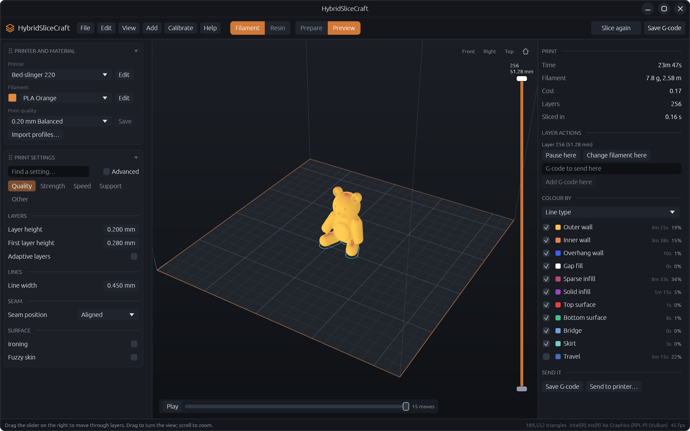
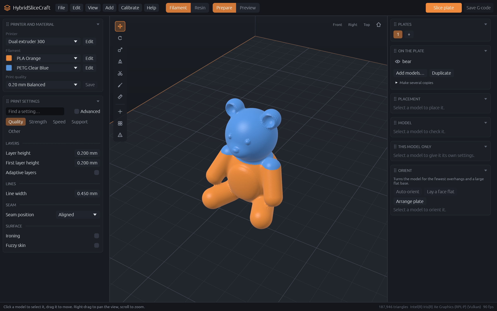
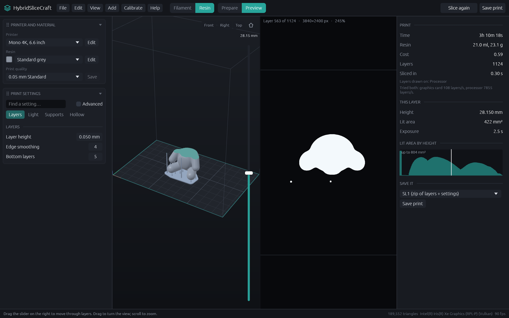
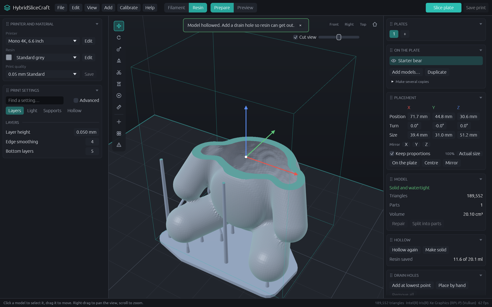

# HybridSliceCraft

A hybrid slicer for filament (FDM) and resin (MSLA) 3D printers, in one fast desktop program.

## Filament (FDM)

- Walls, gap fill and thin-wall detection, top and bottom skins, bridges and overhang slow-down
- Fourteen infill patterns: grid, lines, rectilinear, triangles, cubic, quarter cubic, stars, gyroid, honeycomb, concentric, cross hatch, lightning-style, Hilbert curve, Archimedean chords
- Grid and tree supports with interface layers
- Skirt, brim (outside, inside holes or both) and raft
- Seam placement, ironing (all top surfaces, topmost only, or all solid layers), fuzzy skin (outline, holes or both), spiral vase, adaptive layer heights
- Several filaments in one print, with a prime tower
- **Paint with filaments**: brush, fill and erase tools colour the model's surface; each colour prints with its own filament and reaches a chosen depth into the part
- **A filament for each feature**: pick a different filament for a model's walls, inner walls, sparse infill, solid infill, top surface, bottom surface, support and support interface, for example a flexible or soluble support interface, or a different colour for the inner walls
- **Several nozzle sizes in one print**: each tool can have its own nozzle (for example 0.4 mm and 0.8 mm). Every kind of line follows the size of the nozzle that prints it: outer walls, inner walls, solid infill, sparse infill, support and support interface each get their width from their own tool, so a fine 0.4 mm nozzle can print the outer wall while a 0.6 mm one prints the rest. A model can also print its walls with the fine nozzle and its infill with the big one, for speed without losing surface detail.
- Cooling, time and filament estimates that account for acceleration
- Wall order options (inner-outer-inner, reversed direction)
- **Pause, filament change or any G-code at a layer**: add them from the preview at the layer the slider is on; they are saved in the project
- Acceleration, flow ratio and (for bridges, support interface and ironing) fan speed for each kind of line, and walls that slow down in four steps by how much they hang in the air
- Z-hop types (straight, slope or spiral), lift only between two heights, retract at every layer change, and machine limits (speed, acceleration, corner speed) sent to Marlin, Klipper or RepRapFirmware
- Input shaper settings and object labels so a failed object can be skipped mid-print (Klipper, Marlin)
- Snapmaker U1 printer presets (four tool heads, five nozzle choices), with start and end scripts from OrcaSlicer's profile
- Arc fitting (G2/G3), pressure advance, Marlin, Klipper and RepRapFirmware output
- Preview by line type, speed, flow, layer height, width, fan, temperature, layer time or filament
- Calibration tests: temperature tower, flow, max flow tower, speed ripple tower, retraction, pressure advance, first layer
- Sending to OctoPrint or Moonraker printers over the local network

## Resin (MSLA)

- Automatic supports with thin, shallow tips that snap off cleanly, kept clear of the model along their whole length, with branches, cross-bracing and a raft, plus hand-placed supports
- A check that warns about any part that would start in mid-air
- Hollowing with chosen wall thickness and an optional inner lattice, plus drain holes placed at the lowest point or by hand
- A check for resin trapped inside the print
- Edge smoothing (anti-aliasing), bottom and transition layers, elephant-foot correction
- Layer picture viewer, lit-area chart, print time, volume and cost
- Export to SL1, a PNG layer stack (zip) and unencrypted CTB

## Your workspace

- Both side panels are made of cards: Printer and material, Print settings, Plates, On the plate, Placement, Model, Hollow, Drain holes, Orient, Supports.
- **Drag a card by its title** to reorder it, or drop it in the other panel. Click a title to fold the card away.
- Right-click a title to move a card up, down or to the other panel.
- Your layout is remembered. **View → Restore default layout** brings back the original.
- The default order follows a typical resin workflow: size the model, check and repair it, hollow it, orient it, then add supports.

## Also

- Opens STL, OBJ, 3MF and PLY; repairs, cuts, splits, mirrors, lays flat and auto-orients models (from the Orient card, the toolbar, or the O key)
- Several plates, undo and redo, project files, saved presets
- The 3D view draws on the graphics card through Vulkan, Metal, DirectX 12 or OpenGL. Resin layers are drawn on whichever is faster, the graphics card or the processor, timed on each print.

## Install

Each published GitHub release gets installers built automatically:

| System | File |
| --- | --- |
| Windows | `.msi` installer |
| macOS, Apple silicon and Intel | `.dmg` disk image (one for each chip) |
| Linux | `.deb` package and a portable `.AppImage` |

On Debian and Ubuntu you can also install from the apt repository, which keeps the program up to date:

    sudo install -d -m 0755 /etc/apt/keyrings
    curl -fsSL https://jorgen-vikinggod.github.io/HybridSliceCraft/hybridslicecraft.gpg | sudo tee /etc/apt/keyrings/hybridslicecraft.gpg >/dev/null
    echo "deb [signed-by=/etc/apt/keyrings/hybridslicecraft.gpg] https://jorgen-vikinggod.github.io/HybridSliceCraft stable main" | sudo tee /etc/apt/sources.list.d/hybridslicecraft.list
    sudo apt update && sudo apt install hybrid-slice-craft

There is also a Flatpak file (`HybridSliceCraft-<version>-x86_64.flatpak`) on each release:

    flatpak install --user HybridSliceCraft-0.8.0-x86_64.flatpak

The installers aren't code-signed yet. Windows SmartScreen and macOS Gatekeeper will warn on first launch; on macOS, right-click the app and choose Open.

To make installers yourself, install `cargo-packager` (`cargo install cargo-packager --locked`) and run `cargo packager --release` on the system you're building for. They appear in `dist/`.

## Run it

    cargo run --release

Add model files after the command to open them straight away. Run with `--help` to see every option, for example `--printer "dual nozzle"` to start with a given printer, or `--export file.gcode` to slice and save without opening the window.

## Not yet proven

- Printed files haven't been tried on real printers. Check a small print first, especially with the CTB format.
- Only Linux has been built and run so far. Windows and macOS are the intended next targets.
- Printing with two nozzle sizes assumes the printer's firmware handles each tool's offsets, as tool changers and IDEX printers do.

## License

Released under the [MIT License](LICENSE).
