# HybridSliceCraft manual

HybridSliceCraft slices models for **filament (FDM)** printers and **resin (MSLA)** printers in one program. This manual explains every feature, how to use it, and gives examples and hints. The pictures were taken from the program itself.

**Contents**

- [Getting started](#getting-started)
- [Filament (FDM)](#filament-fdm)
  - [Preparing the plate](#preparing-the-plate)
  - [Printers, filaments and print settings](#printers-filaments-and-print-settings)
  - [Importing your own presets](#importing-your-own-presets)
  - [Layers and line width](#layers-and-line-width)
  - [Walls](#walls)
  - [Infill](#infill)
  - [Top and bottom surfaces](#top-and-bottom-surfaces)
  - [Ironing and fuzzy skin](#ironing-and-fuzzy-skin)
  - [Seam and scarf seam](#seam-and-scarf-seam)
  - [Size accuracy: holes, cracks and the first layer](#size-accuracy-holes-cracks-and-the-first-layer)
  - [Supports](#supports)
  - [Skirt, brim and raft](#skirt-brim-and-raft)
  - [Spiral vase](#spiral-vase)
  - [Speed, acceleration, flow and cooling](#speed-acceleration-flow-and-cooling)
  - [Retraction, Z-hop and machine limits](#retraction-z-hop-and-machine-limits)
  - [Several filaments and the prime tower](#several-filaments-and-the-prime-tower)
  - [Painting with filaments](#painting-with-filaments)
  - [A filament for each feature](#a-filament-for-each-feature)
  - [Several nozzle sizes](#several-nozzle-sizes)
  - [Mixed filaments (colour mixing)](#mixed-filaments-colour-mixing)
  - [Painting supports, seams and fuzzy skin](#painting-supports-seams-and-fuzzy-skin)
  - [Height ranges](#height-ranges)
  - [Pause, filament change and G-code at a layer](#pause-filament-change-and-g-code-at-a-layer)
  - [No-go areas on the bed](#no-go-areas-on-the-bed)
  - [The preview](#the-preview)
  - [Calibration tests](#calibration-tests)
  - [Saving and sending the print](#saving-and-sending-the-print)
- [Resin (MSLA)](#resin-msla)
  - [Preparing the plate](#resin-preparing-the-plate)
  - [Printer, material and print settings](#printer-material-and-print-settings)
  - [Orienting the model](#orienting-the-model)
  - [Supports](#resin-supports)
  - [Hollowing and drain holes](#hollowing-and-drain-holes)
  - [Floating parts and trapped resin](#floating-parts-and-trapped-resin)
  - [Smoothing, bottom layers and elephant foot](#smoothing-bottom-layers-and-elephant-foot)
  - [Exposure test piece](#exposure-test-piece)
  - [The preview and cut view](#the-resin-preview-and-cut-view)
  - [Saving the print](#saving-the-print)
- [Use with AI agents (MCP)](#use-with-ai-agents-mcp)
- [Tips for both](#tips-for-both)
- [Keyboard shortcuts](#keyboard-shortcuts)
- [Command line](#command-line)

> **Not yet tried on real printers.** The files the program writes haven't been checked on every printer. Print something small first, especially with a new printer, a new file type (such as CTB) or a new feature.

---

## Getting started

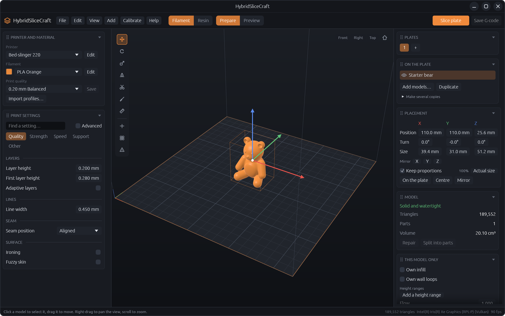

1. **Add a model** with **File → Add models…** (Ctrl+O), by dropping a file onto the window, or from the **Add** menu (a starter bear, a cube, a cylinder or a sphere). The program opens STL, OBJ, 3MF, PLY and STEP (.step, .stp) files.
2. **Choose Filament or Resin** at the top. The two modes keep their own printer, material and settings.
3. Pick the **printer** and **material** in the left panel, then the **print quality** preset.
4. Press **Slice plate** (Ctrl+R). When it is done the view switches to **Preview**; Tab flips between *Prepare* and *Preview*.
5. **Save G-code** (filament) or **Save print** (resin), or send it to a network printer.

**Your workspace.** Both side panels are made of cards: drag a card by its title to reorder it or move it to the other panel, click a title to fold it away, right-click for *Move up, down, to the other panel*. **View → Restore default layout** puts everything back. The program remembers your layout, language and theme (View → Theme, View → Language).

**Hint:** the search box above the print settings (*Find a setting…*) finds a setting in every tab. Turn on **Advanced** to see the settings that are hidden by default.

---

# Filament (FDM)

## Preparing the plate


- **Move, Turn, Resize** (keys M, R, S): drag the arrows or rings on the model, or type exact values in the **Placement** card (*Position*, *Turn*, *Size*). *Keep proportions* scales evenly; *Actual size* goes back to 100%.
- **Lay a face flat** (F): click a face, and the model turns so that face lies on the plate. 
- **Cut** (C): slices the model with a plane; useful to split a big model or to print it flat.
  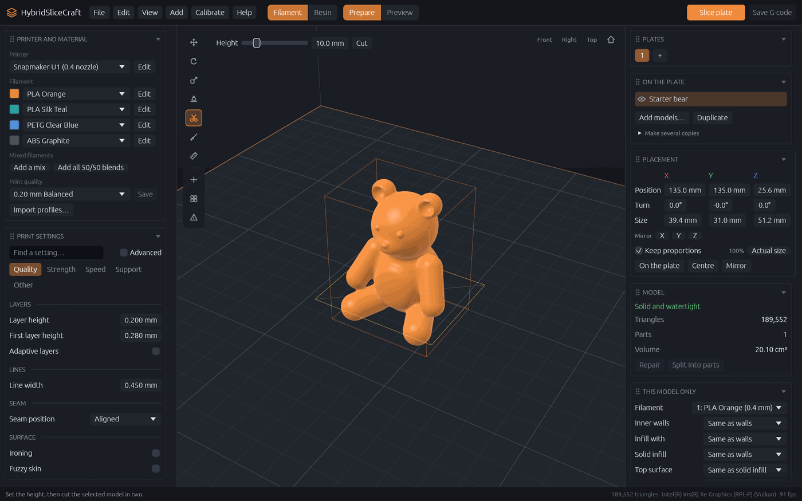
- **Measure**: click two points to read the distance.
  
- **Arrange the plate** (A) packs the models; **Auto-orient** (O) turns a model so it needs the fewest supports. **On the plate** lowers it to the bed.
- **Repair** (in the *Model* card) fixes holes and faces pointing the wrong way; **Split into parts** separates pieces that are not joined. The card tells you if the model is *Solid and watertight*.
- **Several copies:** *Duplicate* (Ctrl+D) or *Make several copies* with the space between them. **Several plates** (the *Plates* card) hold different arrangements in one project.
- **Undo / Redo** (Ctrl+Z, Ctrl+Shift+Z).

**Examples**
- A statue with a flat back: use *Lay a face flat* on the back, so it needs no support there.
- A tall thin model: *Cut* it in two halves and print each half flat; glue them afterwards.

**STEP files.** A STEP file holds exact curved surfaces, which the program cuts into fine triangles, converting the file's unit (mm, cm, m, inch) to millimetres. Some STEP files use shapes the reader can't handle yet; then the program says so. Export STL or 3MF from your CAD program in that case.

## Printers, filaments and print settings

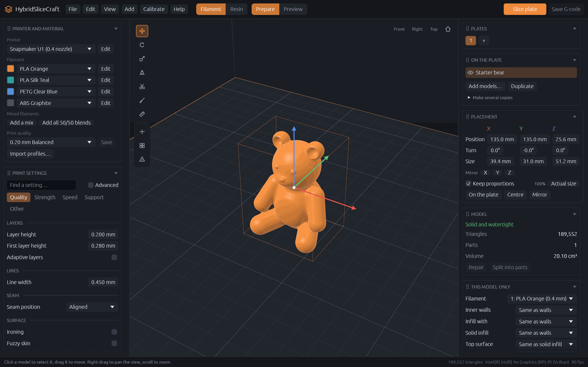

- **Printer**: choose one from the list or press **Edit** to change bed size, nozzle, firmware (Marlin, Klipper, RepRapFirmware), retraction, start and end scripts. *Keep this printer in my list* saves your changes as your own printer.
  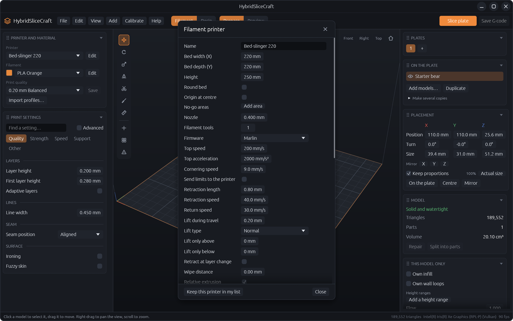
- **Filament**: one list per tool head. **Edit** changes temperatures, fan, flow, pressure advance and cost.
  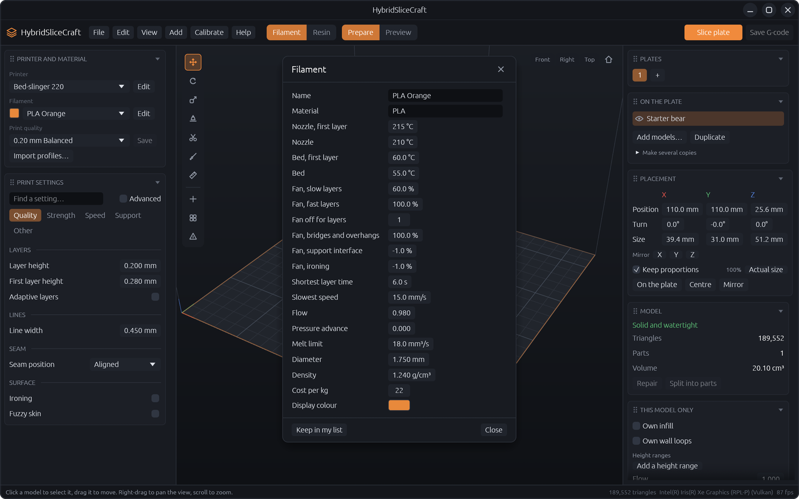
- **Print quality** presets: *0.20 mm Balanced*, *0.20 mm Strong (40% infill)*, *0.20 mm Vase* and more. Change any setting and the preset shows a star; **Save** keeps it as your own preset (named with "(mine)" when it would replace a built-in one).
- A **Snapmaker U1** is included with four tool heads, five nozzle sizes and the start/end scripts it needs.

**Scripts** in the printer window can use `{bed_temp}`, `{nozzle_temp}`, `{bed_x}`, `{bed_y}`, `{height}`, `{layer_height}`, `{filament_type}`, `{nozzle_temp-50}` and `{tool}` (in the tool change script).

**Hints**
- Start from the preset closest to what you want, change one thing at a time, and save it under your own name.
- A setting with a small arrow beside it is not at the preset's value; click the arrow to go back.
- You can paste text into the script boxes from other programs.

## Importing your own presets

**Import profiles…** (under the print quality list) reads printer, filament and print presets you exported from OrcaSlicer or Bambu Studio: plain `.json` files or their export bundles (`.orca_printer`, `.orca_filament`, `.bbscfg`, `.bbsflmt`, `.zip`).

- Choose several files at once; a preset that inherits from another is completed from the files you picked.
- A report lists parent presets that were missing (their settings come from our defaults) and settings that have no counterpart here. Nothing is dropped silently.
- Imported presets never replace built-in ones; a clashing name gets "(imported)" added.
- Start and end scripts are copied; a few placeholders are translated (bed and nozzle temperature, filament type, layer height). Check other placeholders by hand before printing.

## Layers and line width

*Print settings → Quality.* **Layer height** (thinner is smoother and slower), **First layer height** (a thicker first layer sticks better), **Adaptive layers** (finer layers on gentle curves, thicker on straight sides; *Adaptive quality* sets how strong), **Line width**, **Outer wall width** and **First layer width**.

**Example:** a 0.4 mm nozzle prints well at 0.2 mm layers; use 0.12 mm for a smooth miniature and 0.28 mm for a quick draft. The program warns when the layers are thick for the nozzle.

**Hint:** line widths follow the nozzle of the tool that prints each feature (see [Several nozzle sizes](#several-nozzle-sizes)).

## Walls

*Print settings → Strength → Walls.*

- **Wall loops**: more walls make a stronger part. Two is normal, three or four for functional parts.
- **Outer wall first**: better accuracy, slightly worse overhangs. **Inner-outer-inner walls**: first inner wall, then outer, then the rest (needs three or more); clean overhangs with good accuracy.
- **One wall on top**: a single wall on islands open to the sky, for a smoother top. **Reverse wall direction**.
- **Detect thin walls** prints features too narrow for a loop; **Fill gaps** fills narrow spaces between walls.

**Hint:** a wall count is set for a whole model under *This model only → Own wall loops*, or for part of its height with [height ranges](#height-ranges).

## Infill

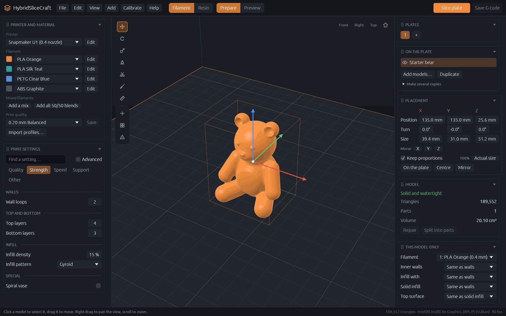

*Print settings → Strength → Infill.* **Infill density** (15% suits most decorative prints), **Infill pattern**, **Infill angle**, **Infill anchor** (longest link between lines) and **Infill overlap**.

**Seventeen patterns:** grid, lines, rectilinear, triangles, cubic, quarter cubic, stars, gyroid, honeycomb, 3D honeycomb, 2D lattice, concentric, cross hatch, lightning, Hilbert curve, Archimedean chords and octagram spiral.

| Want | Try |
| --- | --- |
| Strong in every direction | Gyroid, cubic, 3D honeycomb |
| Fast and light | Lines, grid, lightning (only supports the top skin) |
| Flexible or decorative walls | Concentric, honeycomb |
| Pretty see-through prints | Hilbert curve, octagram spiral |

**Examples:** *0.20 mm Strong (40% infill)* for a bracket; 5% lightning for a vase that only needs its top supported.

**Hints:** give one model its own density with *This model only → Own infill*. Print the infill with a bigger nozzle for speed (see [A filament for each feature](#a-filament-for-each-feature)).

## Top and bottom surfaces

*Print settings → Strength → Top and bottom.* **Top layers**, **Bottom layers**, **Top pattern** and **Bottom pattern** (monotonic, zig-zag, concentric), **Top surface density** and **Bottom surface density** (fill them less than solid to save time; 100 is solid).

Bridges (surfaces printed over air) have **Bridge speed** and **Bridge flow**, and **Thick bridges** (*Support* tab) prints them as round strands as wide as the nozzle, which sag less over long gaps.

**Hint:** four top layers at 0.2 mm give a closed, smooth top. Use more for thin nozzles or low infill.

## Ironing and fuzzy skin

*Print settings → Quality → Surface.*

- **Ironing** runs the hot nozzle over the top surface with very little flow to smooth it. **Ironing type**: all top surfaces, topmost only, or all solid layers. Adjust *Ironing flow*, *spacing* and *speed*. Ironing is slow: use it on small flat tops.
- **Fuzzy skin** roughens outer walls for grip or looks. Choose which walls (*outline*, *holes* or *both*) and the *thickness*. To roughen only a part of a model, [paint it](#painting-supports-seams-and-fuzzy-skin).

**Example:** fuzzy skin on a handle for grip, nothing on the rest.

## Seam and scarf seam

*Print settings → Quality → Seam.*

- **Seam position**: *Aligned* (corners hide it), *Nearest*, *Back* or *Random*. **Seam gap** stops slightly short to hide the join. **Stagger inner seams** keeps inner walls from lining up.
- **Scarf seam** fades the outer wall in and out over a stretch at the seam (*Scarf length*, *Scarf start flow*), so it leaves no bump. It needs a good flow and slow, clean walls to shine.
- **Paint** seam enforcers and blockers to choose where seams go (see below).

**Hint:** put the seam at the back of the model (*Back*) or on a sharp inside corner (*Aligned*).

## Size accuracy: holes, cracks and the first layer

*Print settings → Quality → Size accuracy.*

- **Size correction**: grow or shrink outlines to match real measurements. **Hole size correction** moves holes on their own (positive makes them bigger).
- **Polyholes**: redraw small round holes as polygons that print to size (*Polyhole up to* sets the largest hole). Great for holes that take a bolt.
- **Close gaps up to**: closes cracks in the model's skin up to this width while slicing; handy for models with tiny holes in the surface.
- **Elephant foot fix**: pulls the first layer in so it doesn't bulge.

**Example:** print a 5 mm hole test; if the bolt does not fit, set *Hole size correction* to 0.1 mm.

## Supports


*Print settings → Support.*


- **Support type**: none, normal (grid) or tree. Tree supports use less plastic and are easier to remove.
- **Support style** (normal supports): *Snug* follows the outline of what it holds up; *Grid* fills a rectangle around it.
- **Support from angle**, **Only from the plate**, **Top gap** (empty layers between support and model), **Side gap**, **Support spacing**, **Interface layers** and **Interface spacing** (dense layers just under the model), and for tree supports **Tree branch angle** and **Tree tip radius**.
- A different filament for the support and its interface (for example soluble) is chosen under [A filament for each feature](#a-filament-for-each-feature).
- To add or forbid supports in chosen places, [paint support enforcers and blockers](#painting-supports-seams-and-fuzzy-skin).

**Examples:** tree supports for a figure with outstretched arms; normal supports with *Only from the plate* for a bridge-like part.

**Hints:** more *Top gap* means easier removal but a rougher underside. A 0.2 mm gap with 2 interface layers is a good start.

## Skirt, brim and raft

*Print settings → Other → Bed adhesion.*

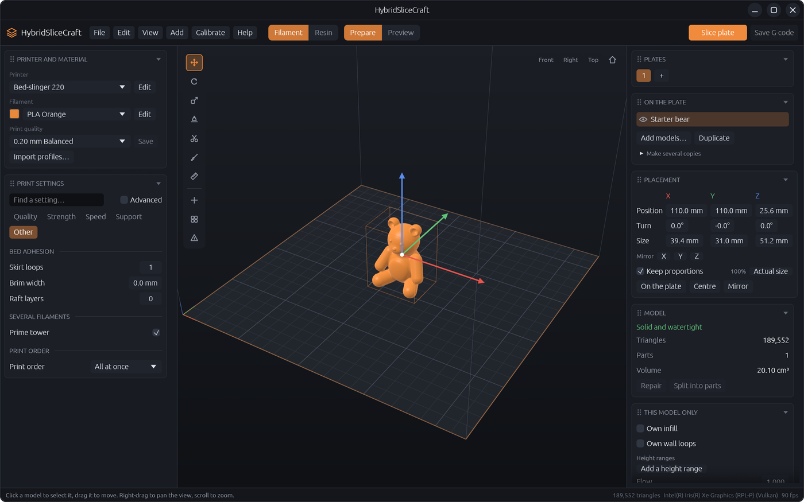

- **Skirt loops** and **Skirt distance**: lines around the print that prime the nozzle.
- **Brim width** and **Brim type** (outside, inside holes, both, or **mouse ears**): a flat border that helps parts stay down. *Mouse ears* put round pads only at sharp outer corners (*Mouse ear angle*), where parts lift first, using far less plastic than a full brim.
- **Raft layers** and **Raft margin**: a disposable base under the whole print.

**Example:** a tall thin box that lifts at its corners: brim type *Mouse ears*, width 6 mm.

## Spiral vase

*Print settings → Strength → Special → Spiral vase.* One continuous wall rising in a spiral with no top. Pick the *0.20 mm Vase* preset, and print a hollow model with a solid base (bottom layers).

## Speed, acceleration, flow and cooling

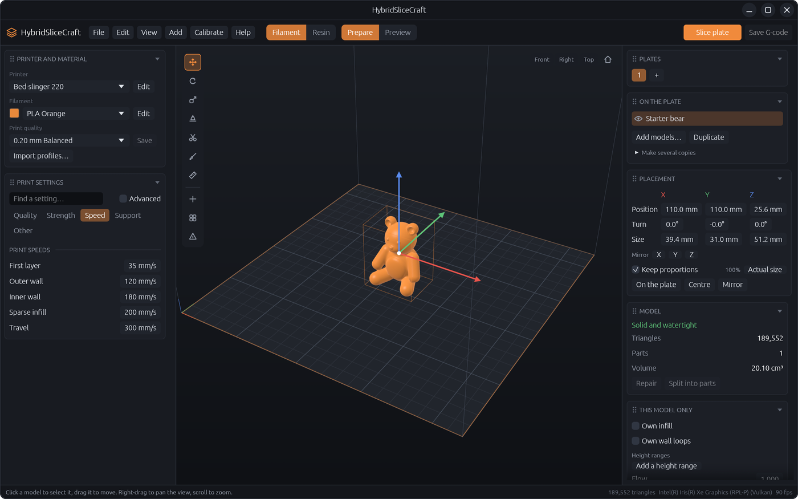

- **Speeds** for every kind of line: first layer, outer and inner walls, sparse and solid infill, top surface, gap fill, support, bridge, overhang, ironing, travel.
- **Slow down by overhang**: walls slow down in four steps by how much of the line hangs in the air (up to 25%, 50%, 75%, 100%).
- **Acceleration** for outer walls, inner walls, infill, top surface, bridges, first layer and travel (zero follows the default). The preview's time estimate accounts for acceleration.
- **Flow ratios** for each kind of line (*Print settings → Other*), on top of the filament's flow.
- **Fan** (filament window): *Fan, slow layers* and *Fan, fast layers*, *Fan off for layers* at the start, and extra for *bridges and overhangs*, *support interface* and *ironing*. Cooling slows small layers (*Shortest layer time*, *Slowest speed*).
- **Melt limit** (filament window) limits the speed so the nozzle is never asked to melt more than it can.

**Hints:** if the preview colours by *Flow* show red, the nozzle can't melt that fast; lower the speeds. Calibrate with the [calibration tests](#calibration-tests).

## Retraction, Z-hop and machine limits

*Printer window.*

- **Retraction length**, **Retraction speed**, **Return speed** and **Wipe distance**; **Shortest retract distance** (print settings).
- **Z-hop** (*Lift during travel*): *Lift type* straight, **slope** or **spiral**; *Lift only above* / *below* two heights; *Retract at layer change*.
- **Pressure advance** (filament window); **Input shaper X / Y** frequencies and **Label objects** so a failed object can be skipped (Klipper, Marlin).
- **Machine limits** (*Top speed*, *Top acceleration*, *Cornering speed*, and the Z and extruder limits) are sent at the start of a print when *Send limits to the printer* is on.
- **Smooth arcs (G2/G3)** make smaller files and smoother motion. **Relative extrusion** and **Firmware** (Marlin, Klipper, RepRapFirmware) match your printer.

**Hint:** for a bowden printer start with 4–6 mm retraction; for direct drive 0.5–1.5 mm. Print the *Retraction test* to tune it.

## Several filaments and the prime tower

*Print settings → Other → Several filaments.* With a printer that has several tool heads (or a filament changer) you can print with several filaments in one print.

- **Prime tower**: a small tower that clears the old colour after each change. **Tower width**, **Purge per change**, **Tower X / Y**.
- **Flush volumes**: a table with how much to purge when changing from one filament (row) to another (column). Changing from dark to light purges more than the other way round.
- **Print order**: all objects layer by layer, or one object at a time.

**Hint:** place the prime tower where it can't collide with a model; the program moves it when needed. Fewer colour changes means less waste, so put models of one colour together.

## Painting with filaments

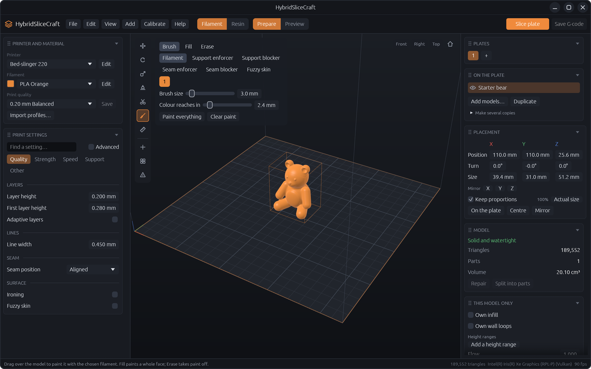

Choose the **paint tool** (brush icon). Pick a filament swatch, then **Brush** (drag over the model), **Fill** (a whole connected face; *Stop at creases over* sets the angle) or **Erase**. **Paint everything** and **Clear paint** act on the whole model. **Colour reaches in** sets how deep the colour goes into the part.

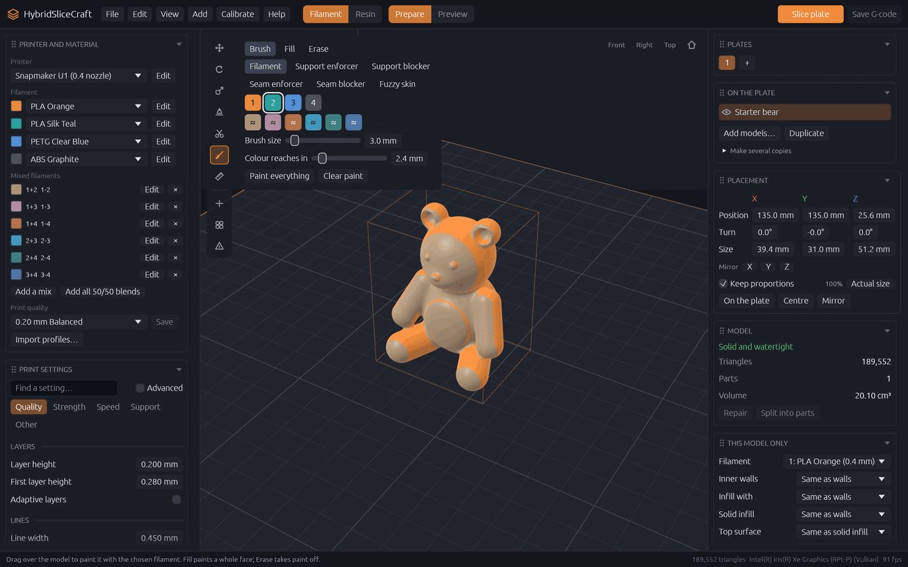

Each colour prints with its own filament, so tool changes and the prime tower come automatically.

**Hints:** a small reach (2–3 mm) paints only a shell and keeps the inside one colour, which saves purging. Large reach gives full-depth colour.

## A filament for each feature

In the **This model only** card choose a filament for a model's **walls**, **inner walls**, **sparse infill**, **solid infill**, **top surface**, **bottom surface**, **support** and **support interface**. Everything left on "Same as walls" follows the main filament.

**Examples:** a flexible or soluble support interface; a different colour for the inner walls (they show through thin translucent outer walls); a strong filament for the infill and a pretty one for the skin.

## Several nozzle sizes

With a printer whose tools have different nozzles (set each tool's nozzle in the printer window) every kind of line gets its width from the nozzle of the tool that prints it. Print the outer wall with a 0.4 mm nozzle for detail and the inner walls and infill with a 0.8 mm nozzle for speed.

**Hint:** the program assumes the printer's firmware applies each tool's offsets, as tool changers and IDEX printers do.

## Mixed filaments (colour mixing)

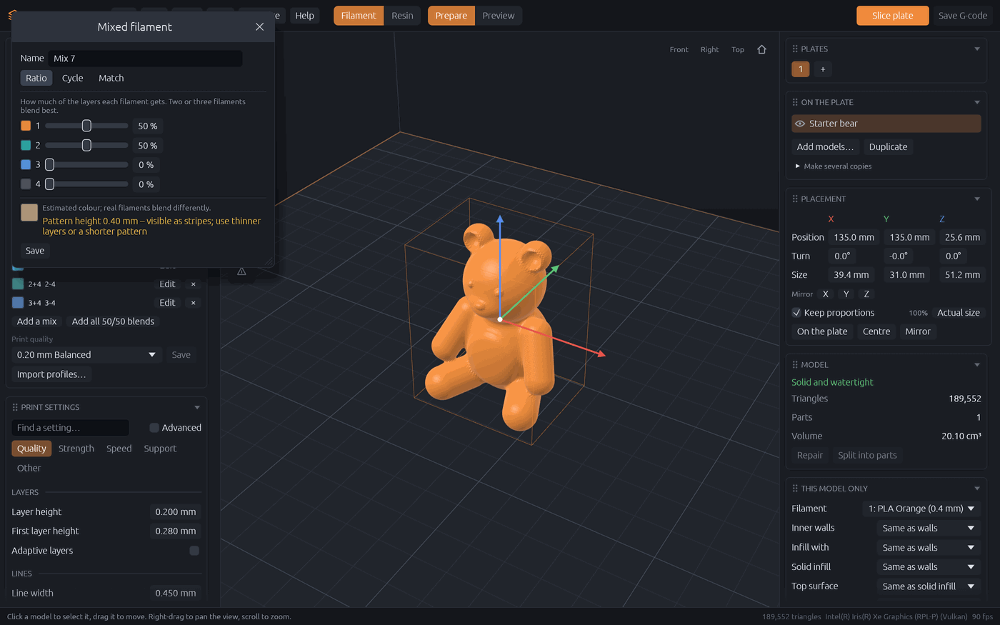

Alternate a few filaments **layer by layer** in a repeating pattern, such as red, yellow, yellow, and the eye blends the thin layers into one colour (orange here). This is often called full-spectrum printing. It suits printers with several tool heads and ornamental prints.

**Make a mix:** under the filaments press **Add a mix** (or **Add all 50/50 blends** for every pair). In the window:

- **Ratio**: set how much of the layers each filament gets; the program builds a short, even pattern.
- **Cycle**: click the filaments in the order they print, e.g. 1-2-2-4.
- **Match**: pick a colour or enter a hex code; the program finds the closest blend of your loaded filaments (*Least share per filament* keeps tiny shares out) and tells you when no blend gets close.

The colour shown is an **estimate**; real filaments blend differently. **Use it** like any filament: choose its swatch (≈) in the [paint tool](#painting-with-filaments) and paint, or *Paint everything*.

**Hints**
- Use **thin layers**, 0.08–0.12 mm, and **short patterns** of 2–4 layers. A pattern taller than about 0.2 mm shows as stripes (the window shows the pattern height).
- **Translucent filament** blends better than very opaque filament, especially black.
- Keep adaptive layers off: the pattern repeats by layer.
- Print flat, and calibrate your tool changer's XY offsets, so the colours line up.
- A thin colour reach keeps the number of tool changes down.

## Painting supports, seams and fuzzy skin


Next to filament colours the paint tool has five more kinds of mark:

- **Support enforcer**: supports appear where you paint, even if supports are off.
- **Support blocker**: no supports in the painted area, however far down it reaches.
- **Seam enforcer / Seam blocker**: choose where outer walls start and where they must not.
- **Fuzzy skin**: roughen only the painted part of the outer wall.

Marks are shown in green, red, blue, orange and violet, and are saved with the project.

**Examples:** block supports inside a decorative hole so it stays clean; enforce a seam along the back edge of a vase; fuzzy skin only on the grip of a handle.

**Hint:** painting a mark replaces another mark on the same triangles, but never removes filament colour.

## Height ranges

In the **This model only** card press **Add a height range** and give a model its own **wall loops**, **infill density** or **infill pattern** between two heights.

**Example:** a tall bracket with 4 walls and 40% infill only in the bottom 20 mm where the bolts go, and 15% above.

## Pause, filament change and G-code at a layer

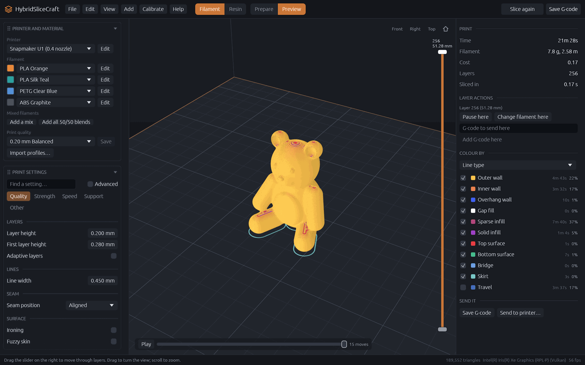

In the preview, move the layer slider to the layer you want, then in **Layer actions**: **Pause here**, **Change filament here**, or type your own G-code and **Add G-code here**. They are saved in the project and put into the G-code when you slice again. The printer window can set the commands the printer uses (otherwise M601, PAUSE or M226 for a pause, and M600 for a filament change).

**Examples:** pause to insert nuts or magnets; change filament at layer 40 for a colour change; send `M117 Halfway there` as a message.

## No-go areas on the bed

In the printer window, **No-go areas → Add area** places a rectangle (x, y, width, depth from the front left corner) that nothing may sit on, such as a clip or a wiper. It is drawn in red on the bed, **Arrange** avoids it, and slicing warns when a model touches it.

## The preview


After slicing: the **Print** card shows **time, filament weight and length, cost and layers**; **Worth checking** lists warnings (thick layers for the nozzle, gaps bridged in the skin, tall mix patterns and more).

- Drag the **layer slider** on the right to step through layers; **Play** replays the print.
- **Colour by** picks how lines are coloured: line type, speed, flow, layer height, width, fan, temperature, layer time or filament. Tick lines on or off in the legend (for example hide *Travel*).
  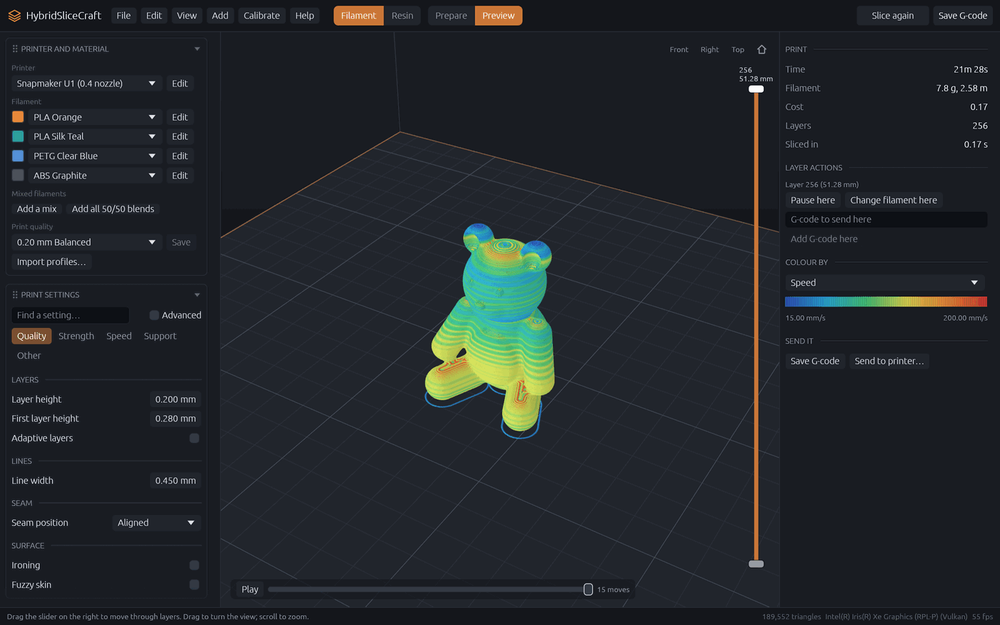
  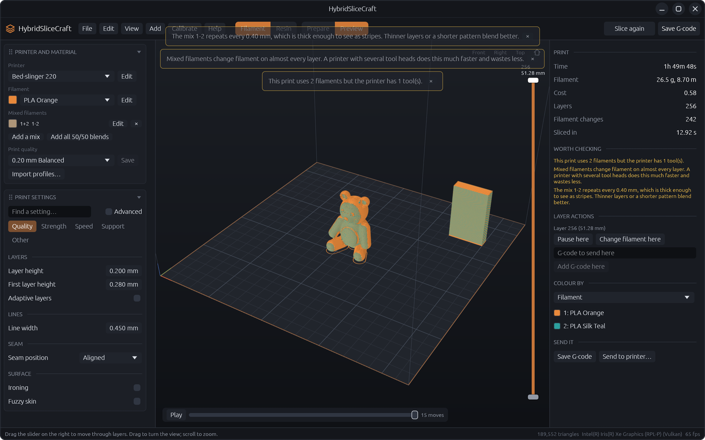
- The legend shows the time and share of each line type, which helps find what makes a print slow.

**Hint:** colour by *Speed* to see where the printer slows down, and by *Flow* to find lines that are too fast for the nozzle.

## Calibration tests

*Calibrate* menu: **Temperature tower**, **Flow test**, **Retraction test**, **Pressure advance tower**, **Max flow tower**, **Speed ripple tower** and **First layer test**. Each adds a ready-made model with the right changes at the right heights (temperature, retraction, pressure advance, speed or flow). Slice, print, and read off the best height.

**Example:** print the *Temperature tower* for a new spool, find the cleanest section and set that temperature in the filament window.

## Saving and sending the print

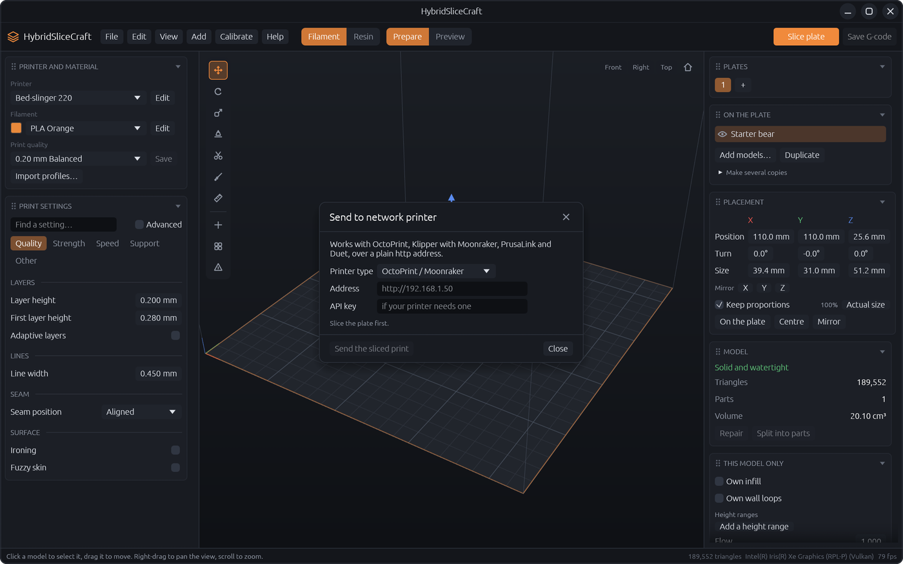

- **Save G-code** (Ctrl+E) writes the file for an SD card or USB stick.
- **Send to printer…** (also *File → Send to network printer…*) uploads over your network to **OctoPrint, Moonraker (Klipper), PrusaLink or Duet**. Choose the printer type, type its **Address** (`http://192.168.1.50`) and the **API key** if it needs one. Plain `http://` addresses only.
- **Save project** (Ctrl+S) keeps plates, models, paint, mixes, settings and layer actions in one file you can reopen later.

---

# Resin (MSLA)

Switch to **Resin** at the top. The program has presets for Elegoo and Anycubic printers (screen size, build volume and file type) and can write SL1, a PNG layer stack (zip), unencrypted CTB and several Anycubic types.

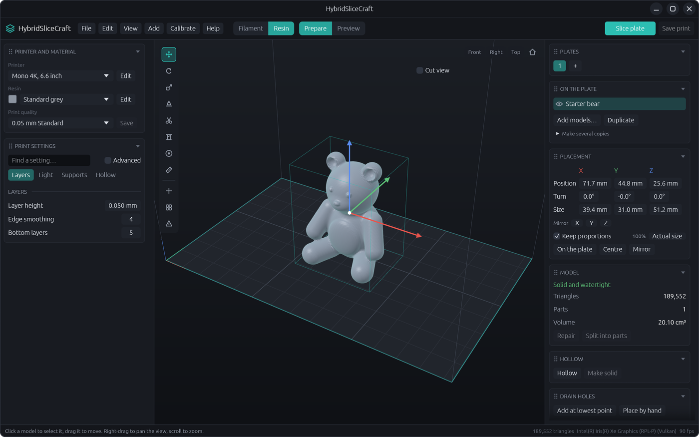

## Resin: preparing the plate

Everything in [Preparing the plate](#preparing-the-plate) (move, turn, resize, lay flat, cut, arrange, repair, split, plates, undo) works the same. The resin cards are **Printer and material**, **Print settings**, **Plates**, **On the plate**, **Placement**, **Model**, **Hollow**, **Drain holes**, **Orient** and **Supports**; the default order follows a typical workflow: size the model, check and repair it, hollow it, orient it, then add supports.

**Hint:** drag cards to the order you like; your layout is remembered.

## Printer, material and print settings

- **Printer**: choose your machine. **Edit** shows the screen resolution and size, build height and file type.
- **Material**: a resin with its **Exposure**, **Bottom exposure**, **Density**, **Cost per litre** and display colour, for example *Standard grey* or *ABS-like black*. Edit it to match your bottle.
- **Print quality** presets: *0.025 mm Ultra detail*, *0.035 mm Miniature*, *0.05 mm Standard*, *0.10 mm Fast draft*. Save your own.
- **Print settings** tabs: **Layers**, **Light**, **Supports**, **Hollow**. Layer height, exposure, lift height and speed, *Light-off delay*, and *Lift off the plate* (room under the model for supports).

**Examples:** 0.05 mm for most prints; 0.025 mm for tiny faces; 0.10 mm for quick test fits.

## Orienting the model

The **Orient** card (and the O key) tilts the model to spread the peel forces and keep surfaces facing down to a minimum. **Do this before adding supports:** turning a model clears its supports. The card also shows **How it sits now**: the print height, the area lying on the plate, the *flat roof (suction)* area and the area that *needs support*, with a warning when a big flat roof would trap resin or the model is tall and narrow enough to sway while peeling.

Other buttons there: **Lay a face flat** (then click a surface) and **Arrange plate**.

**Hint:** large flat surfaces facing the plate pull hard when peeling; a tilt of 15–45° reduces the suction.

## Resin: supports

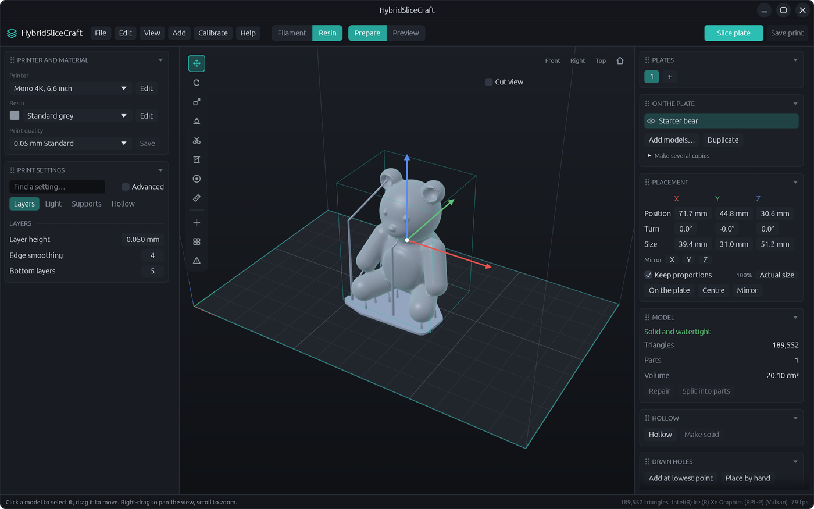

- **Strength**: *Light* (fewer, thinner supports, small marks, for sturdy models), *Medium* (a balance for most models) or *Heavy* (many thick supports for big, heavy or delicate overhangs).
- **Add automatically** lifts the model and places supports wherever it needs holding: thin, shallow tips that snap off cleanly, kept clear of the model along their whole length, with branches, cross-bracing and an optional raft. **Remove all** clears them.
- **Place by hand**: pick the *support point* tool in the toolbar, then click the model where a support should touch it.
  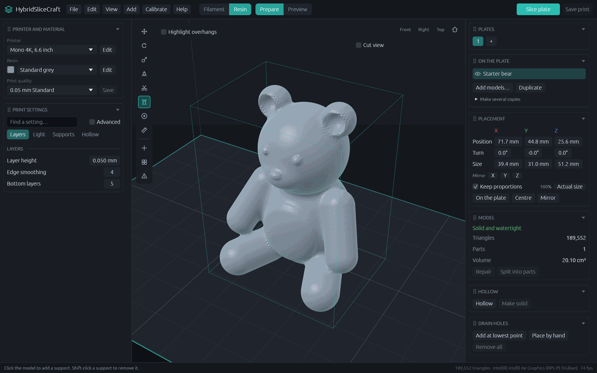
- *Print settings → Supports*: **Support needed from** (angle), **Spacing**, **Tip diameter**, **Contact depth** (shallower snaps off more cleanly, deeper holds better), **Tip length**, **Pillar diameter**, **Base diameter**, **Join pillars within**, **Cross-bracing**, **Allow on the model**, and the **Raft** (thickness, margin, edge slope, vent holes).

**Examples:** tip 0.4 mm and contact depth 0.15 mm for minis; tip 0.8 mm for big heavy parts.

**Hints:** a check warns about any part that would start in mid-air (see below); add supports by hand where it points. Use **Lift off the plate** of at least 5 mm so resin can flow under the model.

## Hollowing and drain holes

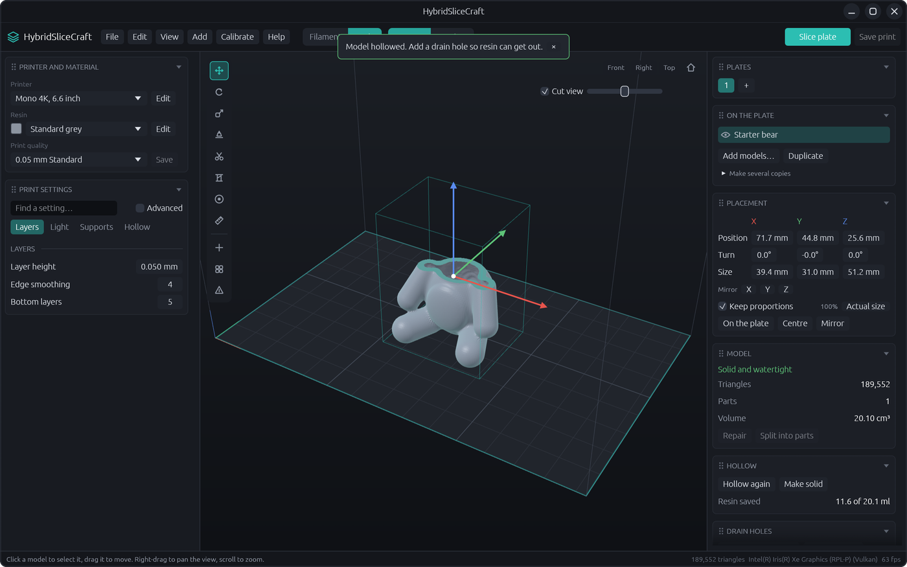

The **Hollow** card makes the model a shell to save resin and reduce peel force: choose **Wall thickness** (thicker is stronger), **Detail** (smaller follows the shape more closely), and optionally an **Inner lattice** (thin bars for strength) with its spacing. **Make solid** undoes it.

A closed hollow traps liquid resin, so add **drain holes**:

- **Add at lowest point**: resin drains out through the bottom.
- **Place by hand**: click the model where a hole should go.
  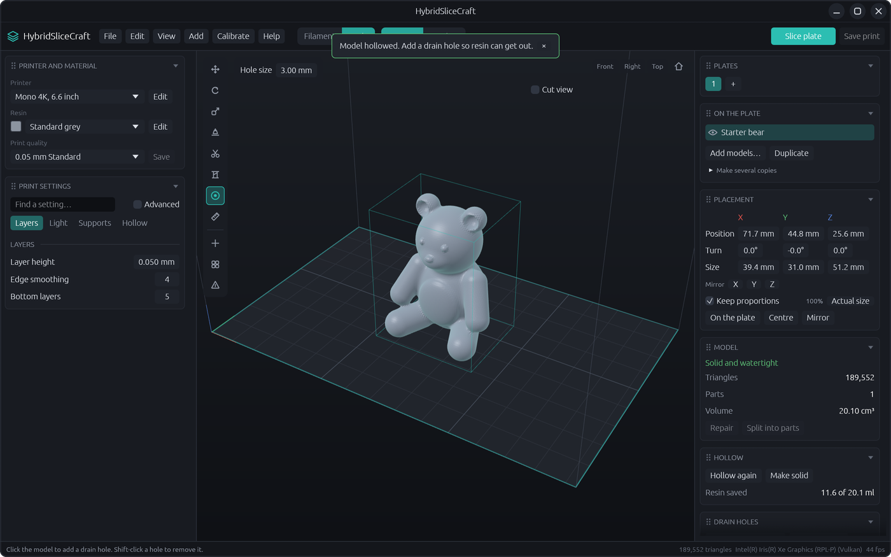
- **Drain hole size** is in the Hollow settings (*Print settings → Hollow*). A hollow print needs holes for the resin to escape.

**Hint:** the *cut view* (see below) shows the inside so you can check the wall; if the model changes size, hollow it again to keep walls right.

## Floating parts and trapped resin

After slicing, **Worth checking** and the **Floating parts** list name every island that would start in mid-air, sorted into *critical*, *minor* and specks, with the area they cover and their height (step through them with *Previous / Next*, *Show this layer*). A separate check finds **resin trapped inside** a hollow print and tells you about how many millilitres would be sealed in, and to add a drain hole.

**Hints:** critical islands need a support; specks can be ignored. Trapped resin means a closed void: add a drain hole or open it.

## Smoothing, bottom layers and elephant foot

*Print settings → Layers.*

- **Edge smoothing** (anti-aliasing) softens pixel steps: 1 is off, 2 or 4 suit most prints, 8 is finest.
- **Z smoothing** draws each layer at several heights and blends them, so sloped surfaces and the top of the model get smooth steps. Slower; drawn on the processor. *Smoothing curve* and *Dimmest grey* tune how partly lit pixels cure.
- **Bottom layers** are cured longer so the print grips the plate; **Transition layers** step down to normal exposure.
- **Elephant foot fix** pulls the bottom layers in to keep their size true.
- **Draw layers on** chooses which part of the computer draws the layer pictures. The default times the graphics card and the processor and takes the faster.

**Hints:** use 4× smoothing as a default; for miniatures with smooth curves add Z smoothing 4. If the base looks too wide, raise the elephant foot fix by 0.05 mm steps.

## Exposure test piece

*Calibrate → Exposure test piece* adds a small plate with **thin pins** (0.3 to 1.5 mm wide), **thin walls** (0.2 to 1 mm), small holes and **overhanging fins** (up to about 8 mm). A note window explains how to use it. Print it at a few exposures, keep the exposure that shows the finest features cleanly, and set it in the material (*Exposure*).

## The resin preview and cut view

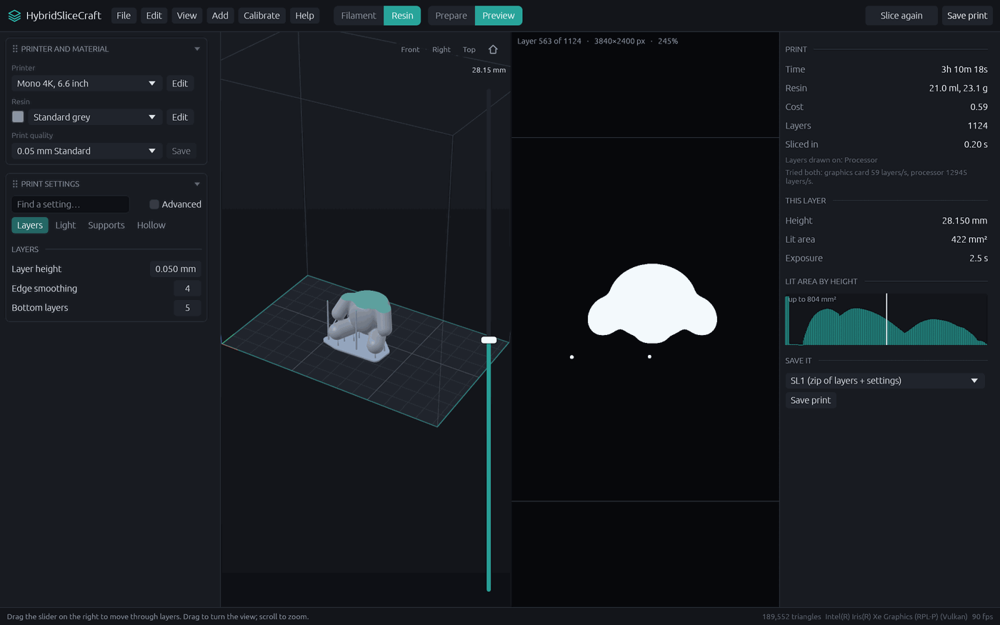

After slicing: the **Print** card shows **time, resin volume and cost**; **This layer** shows height, lit area and exposure; **Lit area by height** is a chart of the area exposed on every layer (sudden jumps mean a big change in peel force). The **layer picture viewer** shows what each layer exposes, with a slider to scrub through layers.

The **cut view** slices the model open so you can look at supports, walls and the lattice inside:

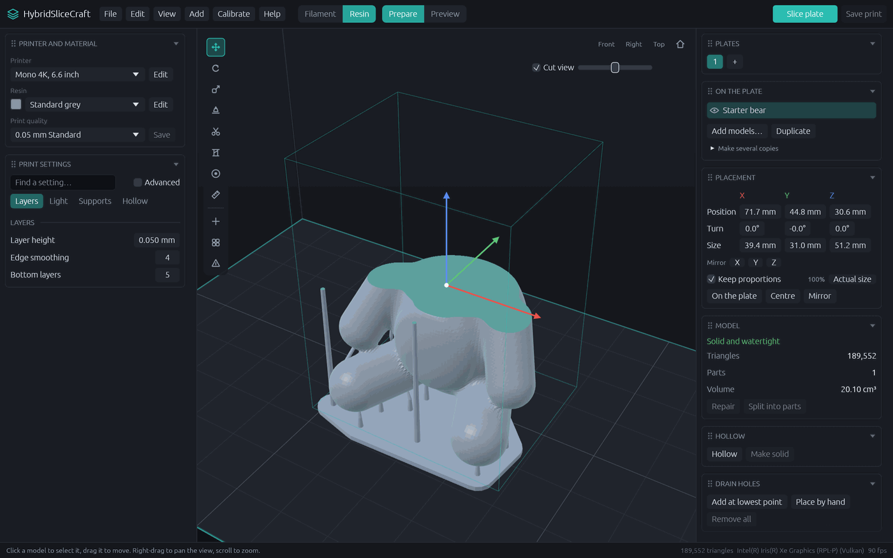

**Hint:** a lit area that suddenly doubles (a large flat surface) is where the print is most likely to fail; tilt the model or add supports there.

## Saving the print

**Save print** (Ctrl+E) writes SL1, a PNG layer stack (zip), CTB (unencrypted) or the Anycubic type for your printer (several are supported; some newer ones must be saved as SL1 and converted with UVtools). A note tells you when a format hasn't been tried on a real printer; check the file in a slicer such as UVtools and print a small test first.

---

# Use with AI agents (MCP)

HybridSliceCraft can run as an **MCP server** (Model Context Protocol), so an AI agent, such as Claude or another assistant that supports MCP, can slice models for you. It runs without a window and talks over standard input and output.

**Start it** with `hybridslicecraft --mcp`. In the settings of your agent program add it as a server. For example, for programs that read a `mcpServers` list (Claude Desktop, Cursor and others):

```json
{
  "mcpServers": {
    "hybridslicecraft": { "command": "hybridslicecraft", "args": ["--mcp"] }
  }
}
```

For Claude Code: `claude mcp add hybridslicecraft -- hybridslicecraft --mcp`. If the program isn't on your PATH, give the full path to it instead (for example `C:\Program Files\HybridSliceCraft\hybridslicecraft.exe`, or the AppImage file).

**What the agent can do**

| Tool | What it does |
| --- | --- |
| `list_catalog` | Lists the printers, filaments, resins and print profiles, including your own and imported ones. |
| `describe_settings` | Lists every setting of a group (print profile, printer, filament, resin profile, resin printer, resin material) with its default and the allowed values of choice settings. |
| `inspect_model` | Reads a model file: size, volume, triangles, and whether it is solid and watertight. |
| `slice_filament` | Slices models (or a calibration model) for a filament printer and writes the G-code. Returns print time, filament use, cost, warnings and a `slice_id`. |
| `slice_resin` | Slices models for a resin printer and writes SL1, PNG zip, CTB, GOO or an Anycubic file. Can add supports, hollow the model and add drain holes. Returns time, resin use, floating parts and trapped resin. |
| `render_layer` | A picture of one layer of a slice: filament layers from above with the line types coloured, resin layers as the exposure picture. |

The manual you are reading is also offered to the agent as the resource `hybridslicecraft://manual`.

**Examples to ask for**

- "Slice `bracket.stl` for the Snapmaker U1 with 4 walls, 25% gyroid infill and tree supports, and tell me the print time."
- "Slice this miniature for my Anycubic Photon Mono 4 at 0.05 mm with supports, hollowed with a drain hole, save it as `.pwmx`, and show me layer 400."
- "Print a temperature tower for the PETG Clear Blue filament."
- "Which of these three models fits on my printer's bed?" (the agent uses `inspect_model` and the printer list.)

**Good to know**

- Settings are changed by name, for example `{"walls": 4, "infill_pattern": "Gyroid"}`. A wrong name or value comes back as a message that says what is allowed, so the agent can correct itself.
- Models without a position are arranged on the bed automatically; with `fit_to_bed` too-large models are shrunk. Models can be placed (`x`, `y`), turned (`rotate_z`), scaled and copied.
- The server reads and writes only the files the agent names. G-code and print files go to a temporary folder unless `output_path` is given.
- Nothing is sent to a printer by this server; the agent gets the file and you decide what to do with it.
- A Flatpak install can't see files outside its sandbox, so use the `.deb`, AppImage, `.msi` or `.dmg` for agents.
- As always, print a small test first.

# Tips for both

- Slice often and look at the preview; most problems are visible there.
- Save a **project** (Ctrl+S) before long edits; **undo** has you covered for most changes.
- Change one setting at a time. Calibration models open a *note* window that says how to read them.
- Test a new printer or feature with a small print.

# Keyboard shortcuts

| Key | Action |
| --- | --- |
| Ctrl+O | Add models |
| Ctrl+S, Ctrl+Shift+S | Save project, save project as |
| Ctrl+R | Slice |
| Ctrl+E | Save the print (G-code or resin file) |
| Ctrl+Z, Ctrl+Shift+Z or Ctrl+Y | Undo, redo |
| Ctrl+D, Ctrl+A, Delete | Duplicate, select all, delete |
| M, R, S | Move, turn, resize tool |
| F, C | Lay a face flat, cut |
| A, O | Arrange the plate, auto-orient |
| Tab | Prepare / preview |
| Home | Reset the view |

You can change the keys in **Help → Keyboard shortcuts**.

# Command line

Run `hybridslicecraft --help` for every option. Useful ones:

- `hybridslicecraft model.stl --printer "Snapmaker U1" --export out.gcode` slices and saves without opening the window.
- `--resin` starts in resin mode; `--slice` slices at start; `--supports`, `--hollow` and `--cut-view` set up a resin model.
- `--bench-fdm model.stl` and `--bench-resin model.stl` time the slicers.
- `--mcp` runs the program as an MCP server for AI agents, with no window (see [Use with AI agents](#use-with-ai-agents-mcp)).
- `--screenshot file.png` saves a picture of the window; with `--tool`, `--tab`, `--window`, `--scheme`, `--demo-paint` and `--demo-mixes` it can open the tool, tab or window you want, which is how the pictures in this manual were made.
