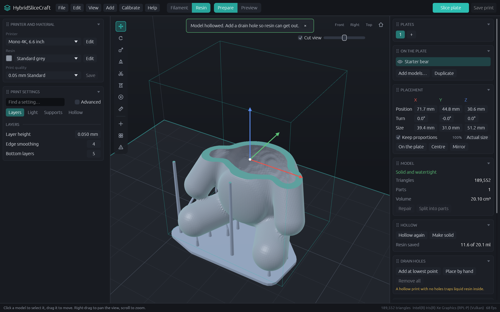

**HybridSliceCraft 0.2.0** lets you arrange the workspace the way you work, and puts auto-orient in the panel next to the other model tools.

Author: Jürgen Könnemann

## New

**Arrange the side panels yourself**
- Both side panels are now made of cards: Printer and material, Print settings, Plates, On the plate, Placement, Model, This model only, Hollow, Drain holes, Orient, Supports.
- Drag a card by its title to reorder it, or drop it into the other panel. A line shows where it will land.
- Click a card's title to fold it away; click again to open it.
- Right-click a title to move the card up, down or to the other panel.
- Your layout is remembered between sessions.
- **View → Restore default layout** (also in each card's right-click menu) brings back the original arrangement.

**Orient card**
- Auto-orient, Lay a face flat and Arrange plate now sit together in an Orient card.
- In resin mode, the default order follows the usual workflow: size the model, check and repair it, hollow it, orient it, then add supports.
- The card notes that turning a resin model clears its supports, so orient before adding them.

**Smaller improvements**
- The Drain holes card has a "Place by hand" button that switches straight to the hole tool.
- Cards that need a model say so when nothing is selected, instead of disappearing.
- All cards in a panel line up at the same width.

## Upgrading

Settings and printer choices carry over from 0.1.0. The panels start in the new default layout.

## Installers

| System | File |
| --- | --- |
| Windows | `.msi` installer |
| macOS, Apple silicon and Intel | `.dmg` disk image (one for each chip) |
| Linux | `.deb` package and a portable `.AppImage` |

The installers aren't code-signed yet. Windows SmartScreen and macOS Gatekeeper will warn on first launch; on macOS, right-click the app and choose Open.

## Known limits

- Files still haven't been tried on real printers. Start with a small print, especially with the CTB format.
- Not included yet: brush-painting colours onto a model, live printer camera and control, encrypted resin formats, and cloud model libraries.

The full feature list is in the [0.1.0 release notes](https://github.com/Jorgen-VikingGod/HybridSliceCraft/blob/v0.2.0/release-notes/v0.1.0.md).
